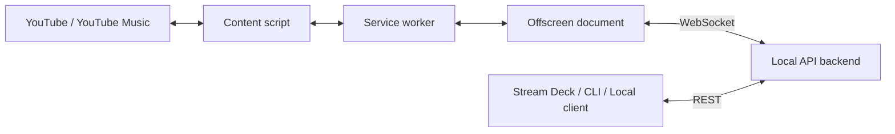

# Chrome Media Control

YouTube와 YouTube Music의 재생 상태를 로컬 REST API로 제공하고, API 명령을 Chrome 탭의 실제 플레이어 동작으로 연결하는 Manifest V3 확장 프로그램입니다.

> 이 프로젝트는 `127.0.0.1` 전용입니다. 인터넷이나 LAN에 노출되는 원격 제어 서버를 목표로 하지 않습니다.

## 주요 기능

- YouTube 및 YouTube Music 재생 상태 조회
- 재생, 일시 정지, 토글, 이전·다음 항목 제어
- 추천 목록 조회 및 항목 선택
- 명령별 `requestId`와 실행 결과 추적
- 서비스별 독립적인 Primary 탭 선택
- 서비스 워커 재시작 후 현재 Chrome 세션의 탭 선택 복원
- 백엔드 연결 중단 시 지수 backoff 방식 자동 재연결

## 동작 구조



- 콘텐츠 스크립트가 플레이어 상태와 추천 목록을 읽고 실제 명령을 실행합니다.
- 서비스 워커가 여러 탭 중 제어할 Primary 탭을 결정합니다.
- 오프스크린 문서가 백엔드와 장기 WebSocket 연결을 유지합니다.
- 로컬 클라이언트는 REST API로 상태를 읽고 명령을 생성합니다.

## 요구 사항

- Node.js 및 npm
- Manifest V3 확장을 로드할 수 있는 최신 Chrome
- YouTube 또는 YouTube Music 탭

## 빠른 시작

### 1. 설치 및 빌드

```powershell
npm install
npm run build
```

빌드 결과는 다음 위치에 생성됩니다.

- `dist`: Chrome 확장 프로그램
- `backend-dist`: 로컬 API 백엔드

### 2. 백엔드 실행

```powershell
npm run start:backend
```

기본 주소는 `http://127.0.0.1:17832`입니다. 같은 포트를 사용하는 기존 프로그램이 있다면 먼저 종료해야 합니다.

### 3. Chrome 확장 로드

1. Chrome에서 `chrome://extensions`를 엽니다.
2. **개발자 모드**를 활성화합니다.
3. **압축해제된 확장 프로그램을 로드합니다**를 선택합니다.
4. 이 저장소의 `dist` 폴더를 지정합니다.
5. YouTube 또는 YouTube Music 페이지를 새로고침합니다.

manifest 권한이나 확장 코드를 변경해 다시 빌드했다면 `chrome://extensions`에서 확장을 다시 로드해야 합니다.

### 4. 연결 확인

```powershell
Invoke-RestMethod -Uri 'http://127.0.0.1:17832/api/v1/health'
```

확장이 연결된 상태에서는 다음과 같은 응답을 받습니다.

```json
{
  "status": "ok",
  "host": "127.0.0.1",
  "extensionConnected": true,
  "extensionConnections": 1
}
```

API 서버가 확장보다 먼저 실행되지 않아도 확장은 최대 10초 간격으로 다시 연결합니다.

## 복수 탭 선택 정책

YouTube와 YouTube Music은 각각 독립적인 Primary 탭 하나를 유지합니다.

- 사용자가 마지막으로 활성화한 해당 서비스 탭이 Primary가 됩니다.
- 다른 탭의 주기적인 상태 메시지는 Primary 선택을 변경하지 않습니다.
- 상태, 추천 목록, 재생 명령은 항상 같은 Primary 탭을 사용합니다.
- Primary 탭이 닫히거나 지원 URL을 벗어나면 다음 순서로 대체합니다.
  1. 마지막 포커스 창의 활성 미디어 탭
  2. 현재 재생 중인 탭
  3. 가장 최근에 접근한 탭
  4. 동률이면 작은 Chrome 탭 ID
- 선택은 현재 Chrome 세션 동안 보존되며 Chrome을 완전히 종료하면 초기화됩니다.
- 사용 가능한 탭이 없으면 API 상태가 `tabAvailable: false`로 갱신되고 추천 목록은 비워집니다.

## REST API

모든 경로는 `http://127.0.0.1:17832`를 기준으로 합니다. `POST` 요청에는 `Content-Type: application/json`이 필요합니다.

| Method | Path | 설명 |
| --- | --- | --- |
| `GET` | `/api/v1/health` | 서버 및 확장 연결 상태 |
| `GET` | `/api/v1/states` | 모든 미디어 소스의 최신 상태 |
| `GET` | `/api/v1/states/{source}` | 지정한 소스의 최신 상태 |
| `GET` | `/api/v1/recommendations/{source}` | 지정한 소스의 최신 추천 목록 |
| `POST` | `/api/v1/commands` | 플레이어 명령 생성 |
| `POST` | `/api/v1/recommendations/select` | 추천 항목 선택 명령 생성 |
| `GET` | `/api/v1/commands/{requestId}` | 명령 실행 상태 조회 |

`source`는 `youtube` 또는 `youtube_music`입니다.

### 플레이어 상태 조회

```powershell
Invoke-RestMethod -Uri 'http://127.0.0.1:17832/api/v1/states/youtube'
```

```json
{
  "protocolVersion": 1,
  "type": "player-state",
  "timestamp": 1780000000000,
  "source": "youtube",
  "connected": true,
  "tabAvailable": true,
  "playing": true,
  "title": "Example video",
  "artist": "Example channel",
  "currentTime": 42,
  "duration": 240,
  "progress": 17.5,
  "receivedAt": 1780000000100
}
```

아직 상태를 수신하지 못했다면 `404 State is not available`을 반환합니다.

### 플레이어 명령 생성

```powershell
$accepted = Invoke-RestMethod -Uri 'http://127.0.0.1:17832/api/v1/commands' `
  -Method Post `
  -ContentType 'application/json' `
  -Body '{"source":"youtube","command":"toggle"}'

$accepted
```

지원 명령:

- `toggle`
- `play`
- `pause`
- `previous`
- `next`
- `request-state`

확장이 연결되어 있으면 `202 Accepted`와 명령 ID를 반환합니다.

```json
{
  "requestId": "ccbb58d6-658b-4e55-a6c5-25cdcf779e1b",
  "status": "pending"
}
```

실행 결과는 반환된 ID로 조회합니다.

```powershell
Invoke-RestMethod -Uri "http://127.0.0.1:17832/api/v1/commands/$($accepted.requestId)"
```

명령 상태는 `pending`, `succeeded`, `failed` 중 하나입니다. 확장이 연결되지 않았다면 명령 생성 요청은 `503`을 반환합니다.

### 추천 항목 선택

먼저 추천 목록의 `revision`과 항목의 `selectionId`를 조회한 뒤 함께 전달합니다.

```powershell
Invoke-RestMethod -Uri 'http://127.0.0.1:17832/api/v1/recommendations/select' `
  -Method Post `
  -ContentType 'application/json' `
  -Body '{"source":"youtube_music","revision":3,"selectionId":"ytm_0_example"}'
```

탭이나 추천 목록이 변경되어 revision이 오래된 경우 확장이 선택을 거부합니다.

### 주요 HTTP 상태 코드

| 상태 | 의미 |
| --- | --- |
| `200` | 조회 성공 |
| `202` | 명령 접수, 실행 결과 대기 중 |
| `400` | source, command, revision 또는 selectionId 오류 |
| `403` | 허용되지 않은 Host 또는 브라우저 Origin |
| `404` | 아직 상태가 없거나 requestId를 찾을 수 없음 |
| `413` | 요청 본문이 64 KiB 제한을 초과함 |
| `415` | JSON Content-Type 누락 |
| `503` | Chrome 확장이 백엔드에 연결되지 않음 |

## 보안 모델

- 서버는 IPv4 `127.0.0.1`에만 바인딩되며 외부 인터페이스로 변경할 수 없습니다.
- HTTP `Host`가 `127.0.0.1`이 아닌 요청을 거부합니다.
- 브라우저 Origin이 있는 요청은 `chrome-extension://`만 허용합니다.
- 일반 로컬 프로그램처럼 Origin 헤더가 없는 요청은 허용합니다.
- CORS 응답 헤더를 제공하지 않습니다.
- HTTP 요청 본문과 WebSocket payload는 64 KiB로 제한됩니다.
- 상태, 추천 목록과 최근 명령 기록은 메모리에만 저장됩니다.

`127.0.0.1` 제한은 인증을 대신하지 않습니다. 같은 사용자 권한으로 실행되는 다른 로컬 프로그램도 Origin 헤더 없이 API를 호출할 수 있으므로 신뢰할 수 있는 PC에서만 사용하고, reverse proxy·포트 포워딩·터널링으로 외부에 노출하지 마세요.

## 포트 변경

백엔드 리스닝 포트만 다음처럼 변경할 수 있습니다.

```powershell
$env:CHROME_MEDIA_CONTROL_PORT = '18000'
npm run start:backend
```

현재 확장의 WebSocket 주소는 `src/offscreen/websocket-client.ts`에서 `127.0.0.1:17832`로 빌드됩니다. 포트를 변경하려면 `BACKEND_URL`도 같은 포트로 수정하고 확장을 다시 빌드·로드해야 합니다. 일반 사용에는 기본 포트 `17832`를 권장합니다.

## 개발

| 명령 | 설명 |
| --- | --- |
| `npm run dev` | 확장 번들을 watch 모드로 빌드 |
| `npm run typecheck` | 확장 및 백엔드 TypeScript 검사 |
| `npm run lint` | 현재 TypeScript 정적 검사 실행 |
| `npm test` | 전체 Vitest 테스트 실행 |
| `npm run build:extension` | `dist` 확장 빌드 |
| `npm run build:backend` | `backend-dist` 백엔드 빌드 |
| `npm run build` | 확장과 백엔드 전체 빌드 |
| `npm run start:backend` | 빌드된 로컬 API 서버 실행 |

### 프로젝트 구조

```text
src/
├─ backend/      REST 및 WebSocket API 서버
├─ background/   서비스 워커와 Primary 탭 라우팅
├─ content/      YouTube DOM 상태 수집과 플레이어 제어
├─ offscreen/    백엔드 WebSocket 연결
└─ shared/       미디어 소스와 메시지 프로토콜
public/          Chrome manifest와 offscreen HTML
dist/            빌드된 Chrome 확장
backend-dist/    빌드된 Node.js 백엔드
```

변경 후 권장 검증 순서:

```powershell
npm run typecheck
npm test
npm run build
```

## 문제 해결

### `extensionConnected`가 `false`인 경우

1. `npm run start:backend`가 실행 중인지 확인합니다.
2. Chrome에서 `dist` 확장을 다시 로드합니다.
3. YouTube 또는 YouTube Music 탭을 새로고침합니다.
4. 서비스 워커와 오프스크린 문서의 개발자 콘솔을 확인합니다.

### `EADDRINUSE`로 백엔드가 시작되지 않는 경우

다른 프로그램이 `127.0.0.1:17832`를 사용 중입니다. 해당 프로그램을 종료하거나 백엔드와 확장의 포트를 함께 변경하세요.

### 명령 요청이 `503`을 반환하는 경우

백엔드는 실행 중이지만 확장 WebSocket이 연결되지 않은 상태입니다. health 응답과 Chrome 확장 로드 상태를 확인하세요.

### 상태 또는 추천 목록이 갱신되지 않는 경우

- 제어하려는 탭을 한 번 활성화해 Primary로 선택합니다.
- YouTube 페이지를 새로고침해 콘텐츠 스크립트를 다시 주입합니다.
- YouTube Music 추천 목록은 현재 DOM에 재생 대기열이 표시되지 않으면 비어 있을 수 있습니다.

## 현재 제한 사항

- Chrome 이외 Chromium 브라우저는 별도로 검증하지 않았습니다.
- YouTube의 DOM 구조 변경에 따라 메타데이터 또는 추천 목록 추출이 영향을 받을 수 있습니다.
- 백엔드를 재시작하면 저장된 상태와 명령 기록이 초기화됩니다.
- 백엔드 자동 시작, 설치 프로그램, Chrome Web Store 배포 패키지는 포함하지 않습니다.

## 라이선스

이 프로젝트는 **GNU General Public License v3.0 or later**(`GPL-3.0-or-later`)로 배포됩니다.

프로그램을 수정하거나 배포할 때는 GPL-3.0 또는 Free Software Foundation이 발표한 이후 버전의 조건을 선택하여 적용하고, 대응하는 소스 코드를 제공해야 합니다. 자세한 내용은 [LICENSE](LICENSE)를 확인하세요.
